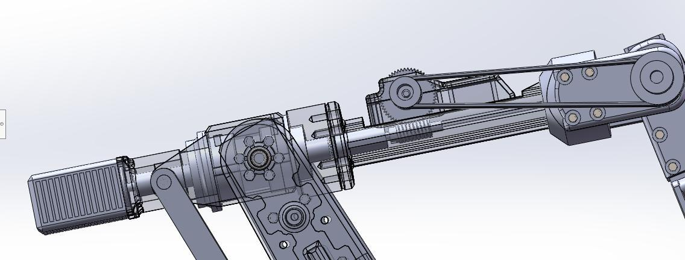
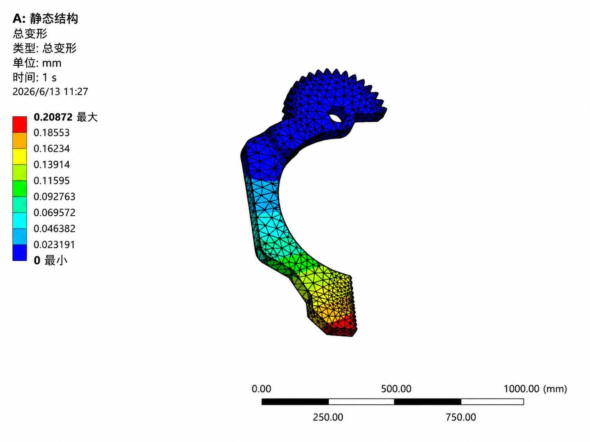

# 快递分拣机器人机械臂结构设计

本科毕业设计，完成机械结构方案、伺服与传动选型、轴系校核及关键零件静力有限元分析。设计材料时间为 **2026 年 5—6 月**。

## 结构概览

面向 0.1–10 kg 中小包裹，设计基座、大臂、小臂、腕部与夹爪机构；完成齿轮、蜗轮蜗杆、带传动及轴承、键、销连接的计算选型。

## 设计与分析记录

- [设计说明与选型摘要](docs/design-summary.md)。
- 原报告中的夹爪静力分析：最大变形 0.20872 mm，载荷条件与结果解释见设计摘要。

本仓库当前采用图片与技术摘要展示，整机和零件 STEP 原模型已从当前分支移除。原始设计文件留存本地。

此次更新未重新开展有限元求解或实物测试；已有图表对应历史设计记录。完整含学号、签字及评审信息的论文保留在本地。

[返回项目档案](https://github.com/Linhcry/project-portfolio)
