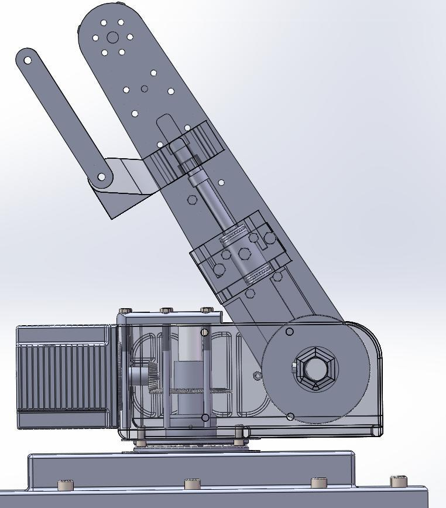

# 快递分拣机器人机械臂结构设计

本科毕业设计，完成机械臂总体方案、主要传动系统计算、三维装配建模及关键结构校核。设计材料时间为 **2026 年 5—6 月**。

## 解决的问题与产出

面向 0.1–10 kg 中小包裹，设计基座、大臂、小臂、腕部与夹爪机构，完成伺服选型、齿轮/蜗轮蜗杆/带传动参数计算，以及轴承、键、销连接校核。

- [整机 STEP 模型](cad/sorting-arm-assembly.STEP)及[结构零件](cad/parts/)。
- [设计说明与选型摘要](docs/design-summary.md)。
- [臂部传动结构](media/arm-transmission.jpg)与[原夹爪有限元变形图](media/gripper-fea-deformation.jpg)。

原报告中的夹爪静力分析结果为最大变形 0.20872 mm，具体载荷和解释见设计说明。此次公开归档未重做有限元求解；这些材料证明设计和历史仿真工作，不能直接代表实物定位精度、负载测试或生产节拍。

使用支持 STEP 的 CAD 工具即可检查几何。总装中的标准件与选型件用于表达装配关系，不宣称为自主开发的商用部件。完整含学号、签字及评审信息的论文保留在本地，公开仓库提供技术摘要。
